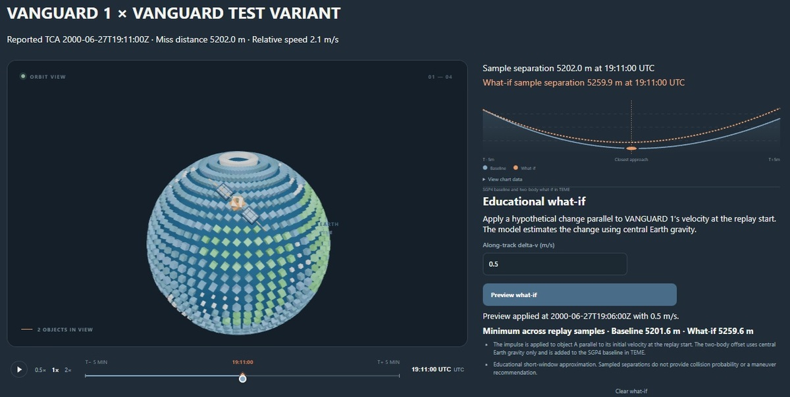
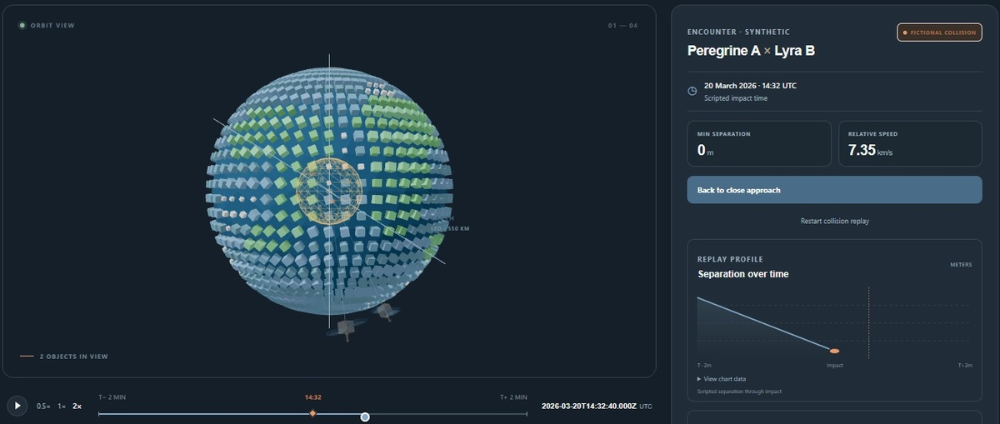
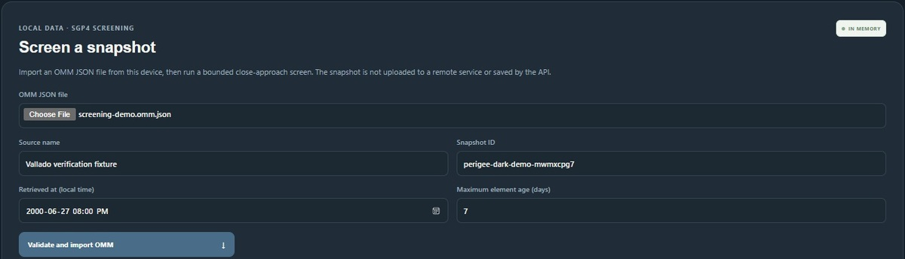

# Perigee

Orbit tracks can cross on a map even when the objects pass through hours apart. Perigee uses time-stamped orbital data to find close passes, then puts the pair and its separation chart on the same 3D replay timeline.

## Demo


## Read a close approach

- **Closest approach · 19:11 UTC** — the moment the modeled positions come nearest during the screening window.
- **Miss distance · 5,202 m** — the gap between those positions at closest approach. A screening threshold decides which passes appear in the results.
- **Relative speed · 2.1 m/s** — the speed of one object relative to the other at that moment. Two satellites can be moving quickly around Earth while moving slowly relative to each other.

Actual contact depends on whether the spacecraft overlap. Estimating collision probability also requires knowing how uncertain their positions are.

### Try a small velocity change

In this replay, a hypothetical **+0.5 m/s** change raises the smallest sampled separation from **5,201.6 m** to **5,259.6 m**. Scrub the scene to see where the two curves diverge. The comparison uses a short-window two-body approximation.



### See the moment of impact

The separate fictional replay brings two scripted tracks together at **0 m**. The camera frames the meeting point and the burst plays at that instant.



## Run locally

Requirements:

- Node.js 18 or newer
- Go 1.23.4 or newer

Start the API:

```powershell
Set-Location apps/api
go run .
```

Start the web app in a second terminal:

```powershell
Set-Location apps/web
npm install
npm run dev
```

Open `http://localhost:5173`. The API health endpoint is available at `http://localhost:8080/api/health`.

Optional Docker Desktop setup:

```text
docker compose up --build
```

Open `http://localhost:5173` after the containers report healthy or become reachable.

## Screen a local OMM snapshot

For a ready-to-import example, use the [two-record verification fixture](data/reference/screening-demo.omm.json) and the dates in the [computed screening walkthrough](docs/DEMO_SCRIPT.md#computed-screening-walkthrough).

Open **Screening**, choose an OMM JSON file, and enter its source, snapshot ID, retrieval time, and maximum element age. The API accepts a single OMM record or an array. A screening run requires 2–100 records with fresh epochs and supported near-Earth SGP4 elements. Enter the screening window in local time, the miss-distance threshold in meters, and the coarse step in seconds. The results show the closest-approach time in UTC, miss distance, relative speed, and model caveats.




The API keeps snapshots and jobs in bounded memory. Restarting the API clears them. Select **Open replay** on a result to scrub the two computed tracks and their separation chart. The TEME replay spans five minutes either side of the reported closest approach and may extend beyond the screening window. In the replay, **Preview what-if** compares sampled separation after a small hypothetical velocity change at the replay start. The preview uses an educational two-body approximation. The standalone Encounter and Maneuver Lab tabs use synthetic fixtures.

## Verify

```powershell
Set-Location apps/web
npm run typecheck
npm run lint
npm run test
npm run build

Set-Location ../api
go test ./...
```

## Current data and limits

The computed example pairs a historical verification record with a synthetic variant. [Screening measurements and reference comparison](docs/BENCHMARKS.md)
