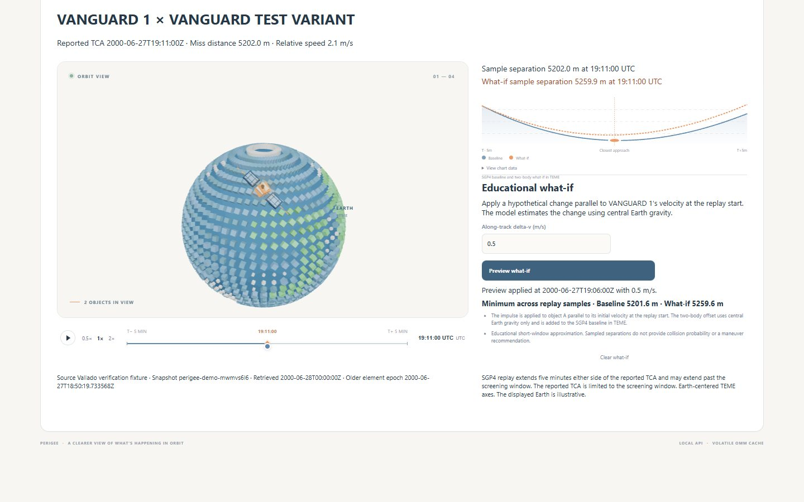

# Perigee

### A clearer view of what's happening in orbit.

Perigee is a local-first orbital traffic visualization and conjunction-screening portfolio app. It combines a voxel Earth interface with deterministic synthetic fixtures and a Go API.

## Demo

[](media/perigee-demo.mp4)

[Watch the demo (MP4)](media/perigee-demo.mp4) · See a fictional impact, then follow OMM import, computed 3D replay, and the completed what-if comparison.

## Run locally

Requirements:

- Node.js 18 or newer
- Go 1.23.4 or newer

Start the API:

```powershell
Set-Location apps/api
go run .
```

Start the web app in a second terminal:

```powershell
Set-Location apps/web
npm install
npm run dev
```

Open `http://localhost:5173`. The API health endpoint is available at `http://localhost:8080/api/health`.

Optional Docker Desktop setup:

```text
docker compose up --build
```

Open `http://localhost:5173` after the containers report healthy or become reachable.

## Screen a local OMM snapshot

For a ready-to-import example, use the [two-record verification fixture](data/reference/screening-demo.omm.json) and the dates in the [computed screening walkthrough](docs/DEMO_SCRIPT.md#computed-screening-walkthrough).

Open **Screening**, choose an OMM JSON file, and enter its source, snapshot ID, retrieval time, and maximum element age. The API accepts a single OMM record or an array. A screening run requires 2–100 records with fresh epochs and supported near-Earth SGP4 elements. Enter the screening window in local time, the miss-distance threshold in meters, and the coarse step in seconds. The results show the closest-approach time in UTC, miss distance, relative speed, and model caveats.

The API keeps snapshots and jobs in bounded memory. Restarting the API clears them. Select **Open replay** on a result to scrub the two computed tracks and their separation chart. The TEME replay spans five minutes either side of the reported closest approach and may extend beyond the screening window. In the replay, **Preview what-if** compares sampled separation after a small hypothetical velocity change at the replay start. The preview uses an educational two-body approximation. The standalone Encounter and Maneuver Lab tabs use synthetic fixtures.

## Verify

```powershell
Set-Location apps/web
npm run typecheck
npm run lint
npm run test
npm run build

Set-Location ../api
go test ./...
```

## Current data and limits

The screening demo uses a historical verification record and a synthetic variant. The standalone Encounter tab includes a separate fictional collision clip, and the standalone Maneuver Lab uses a linearized fixture preview. [Screening measurements and reference comparison](docs/BENCHMARKS.md)
